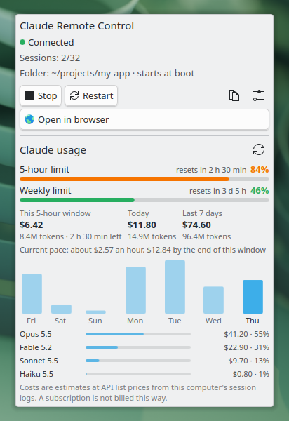
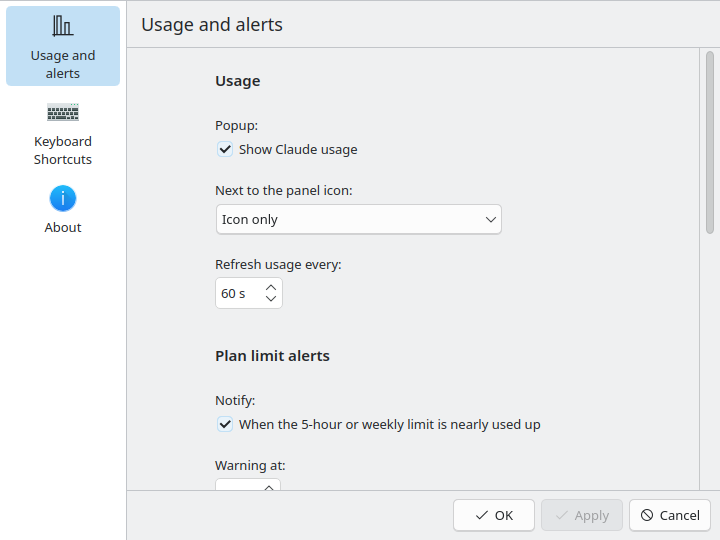

# Claude Remote Control for KDE Plasma 6

Start [Claude Code Remote Control](https://code.claude.com/docs/en/remote-control) automatically at boot, so you can open sessions on your computer from [claude.ai/code](https://claude.ai/code) or the Claude mobile app at any time, and see its status in a Plasma panel widget. The widget also tracks your Claude usage (plan limits, tokens, estimated cost) and notifies you before you run out.

| Status and usage | Settings |
| --- | --- |
|  |  |

The screenshots use sample data.

## What you get

- **`claude-remote-control.service`**: a systemd user service that runs `claude remote-control` in a folder of your choice, starts at boot (even before you log in), and recovers by itself after network drops or crashes. A **watchdog restarts it if it stays disconnected for 60 seconds**, since Remote Control can otherwise sit in "Reconnecting" indefinitely.
- **`claude-rc`**: a terminal command to check, start, stop or restart it.
- **Claude Remote Control widget** (Plasma 6): a panel icon that shows whether it's connected. Click it for a popup with:
  - status (connected / connecting / stopped)
  - number of sessions in use
  - the folder sessions start in
  - **Start/Stop**, **Restart**, **Copy link** and **Open in browser** buttons
- **Claude usage** in the same popup:
  - **plan limits**: how much of your 5-hour and weekly limits is used, and when each resets (needs the one-time step below)
  - **cost and tokens** for the current 5-hour window, today and the last 7 days, with your current pace
  - a bar per day for the last week, and the share of each model
- **Alerts** as desktop notifications, each sent once per period:
  - a plan limit passes the warning (80%) or critical (95%) threshold, or a nearly used-up limit resets
  - today's or the current window's estimated cost passes a budget you set
  - Remote Control has been disconnected for 5 minutes
- A coloured dot on the panel icon while a limit or budget is over its threshold, and optionally the limit percentage or window cost next to the icon.

## Quick Install

```bash
curl -L https://raw.githubusercontent.com/taghouti-org/claude-code-remote-control-plasma/main/install-claude-rc.sh | bash
```

Sessions start in `~/claude-remote` by default. To use another folder:

```bash
curl -L https://raw.githubusercontent.com/taghouti-org/claude-code-remote-control-plasma/main/install-claude-rc.sh | CLAUDE_RC_DIR=~/projects/myapp bash
```

Then add the widget: right-click the panel → **Add Widgets…** → search **"Claude Remote Control"**.

### One-time step: trust the folder

Remote Control only runs in a folder Claude trusts. If the installer says so, run this once and choose **"Yes, I trust this folder"**:

```bash
cd ~/claude-remote && claude
```

The service retries every 30 seconds and connects as soon as the folder is trusted.

### One-time step: plan limits

Claude Code reports your plan limits only to its [status line](https://code.claude.com/docs/en/statusline) command. To let the widget see them, run:

```bash
claude-rc statusline-setup
```

This sets `claude-rc statusline` as the status line in `~/.claude/settings.json` (a backup is saved next to it). If you already have a status line, it keeps working unchanged: `claude-rc` records the limits and then runs yours. The limits show up after your next message in Claude Code, and update while Claude Code is in use. Undo it with `claude-rc statusline-remove`.

Plan limits are reported for Claude Pro, Max and similar subscriptions. Without this step the widget still shows tokens and estimated cost.

### Upgrading

Run the installer again. It keeps the folder your service already uses. Plasma loads the new widget after `systemctl --user restart plasma-plasmashell` or your next login.

> Your home folder itself can't be used: Claude never saves trust for the home directory, for security. Use a subfolder.

## Usage

```bash
claude-rc            # status, plus the claude.ai link for this computer
claude-rc stop       # stop accepting remote sessions
claude-rc start
claude-rc restart
claude-rc logs       # follow the service log
claude-rc json       # machine-readable status (used by the widget)
claude-rc usage      # usage summary as JSON (used by the widget)
claude-rc statusline-setup    # let the widget see your plan limits
claude-rc statusline-remove   # undo that
claude-rc run        # what the service runs (Remote Control with a quiet log)
```

Then open [claude.ai/code](https://claude.ai/code) or the Claude app, pick this computer's environment, and start a session.

## Requirements

- [Claude Code](https://code.claude.com), logged in with a Claude account that has a subscription
- systemd, Python 3 (for the trust check and the usage summary)
- KDE Plasma 6 for the widget (tested on Plasma 6.6, Kubuntu 26.04); the service and `claude-rc` work on any desktop

## What gets installed

| File | Purpose |
|------|---------|
| `~/.config/systemd/user/claude-remote-control.service` | Runs Remote Control; enabled at boot |
| `~/.local/bin/claude-rc` | Helper command |
| `~/.local/bin/claude-rc-usage` | Usage summary and status line recorder |
| `~/.cache/claude-rc/` | Usage cache and the last reported plan limits |
| `~/.local/src/plasma-claude-rc/` | Widget source |
| `~/.local/share/plasma/plasmoids/org.taghouti.clauderc/` | Installed widget |

The installer also runs `loginctl enable-linger` so your user services start at boot without logging in.

## Uninstall

```bash
claude-rc statusline-remove      # only if you ran statusline-setup
systemctl --user disable --now claude-remote-control.service
rm ~/.config/systemd/user/claude-remote-control.service ~/.local/bin/claude-rc ~/.local/bin/claude-rc-usage
rm -rf ~/.cache/claude-rc
systemctl --user daemon-reload
kpackagetool6 -t Plasma/Applet -r org.taghouti.clauderc
rm -rf ~/.local/src/plasma-claude-rc
```

Remove the widget from the panel first if it's there. Lingering stays on; turn it off with `loginctl disable-linger` if nothing else needs it.

## How it works

1. The service runs `claude-rc run`, which starts `claude remote-control` as a persistent server in the chosen folder. It registers this computer as an environment on claude.ai and accepts up to 32 concurrent sessions there.
2. Remote Control redraws its status display several times a second; under systemd that becomes ~300 identical journal lines a minute. `claude-rc run` passes on only lines that changed (connection state, session count, new session links), so the log stays small.
3. It also records the connection state (`up`/`down`) in `$XDG_RUNTIME_DIR/claude-rc.state` whenever it changes ("Reconnected after …" counts as up). If the state stays `down` for 60 seconds, the watchdog stops Remote Control and systemd starts it again 5 seconds later. Change the limit with `Environment=CLAUDE_RC_WATCHDOG_SECS=120` in the service.
4. `claude-rc json` reads the service state from systemd, the connection state from the state file, and the session count (`Capacity: n/32`) and environment link from the current run's journal.
5. The widget runs `claude-rc json` every 5 seconds (every 2 seconds while its popup is open), and calls `claude-rc start|stop|restart` for the buttons.
6. `claude-rc usage` reads the session logs Claude Code keeps in `~/.claude/projects` and adds up the tokens of every response from the last 7 days: per day, per model, and for the current 5-hour window (which opens on the hour of the first message after the previous one closed). It caches what it has read, so each run only reads new lines. Nothing is sent anywhere.
7. Costs are **estimates at API list prices**. A subscription is not billed per token, so read them as a measure of how much you use, not as a bill. The log format is internal to Claude Code and can change between versions; if it does, the token and cost figures may stop updating until this tool is adjusted.
8. Plan limits are the exception: they are not in the logs. `claude-rc statusline` receives them from Claude Code (`rate_limits` in the status line input) and saves the latest values to `~/.cache/claude-rc/limits.json`, which `claude-rc usage` includes. They are therefore as fresh as your last Claude Code message; the widget says so when they are more than 6 hours old.
9. The widget runs `claude-rc usage` every 60 seconds (configurable) and compares the result with your thresholds. Each alert is remembered with the period it belongs to, so it is sent once per limit window or day, also across Plasma restarts.
